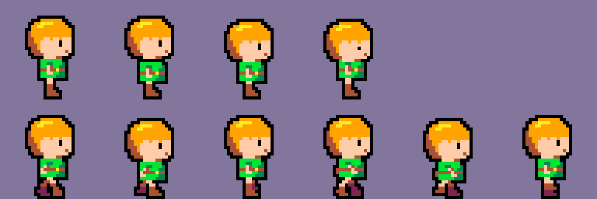
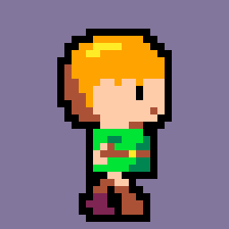
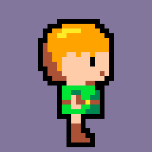

# spritewright

A scriptable, local pixel-art toolkit that turns Python drawing scripts into sprites, animations,
sprite sheets, GIFs and Unity-ready atlases, built to be driven by you or by an AI coding agent.

[](LICENSE)
[](pyproject.toml)
[](https://github.com/MehmetAliAtik/spritewright/actions/workflows/ci.yml)

## Demo

Everything below was produced by one `spritewright build Test_Game Test_Hero` call from the bundled
example in [`examples/Test_Game`](examples/Test_Game) (PICO-8 palette, 32x32 cells; shown upscaled).

| All-animations atlas (Idle row, Walk row) | Walk cycle | Idle |
|---|---|---|
|  |  |  |

The real deliverables are 1x PNGs plus JSON metadata and a Unity import note per animation; the images
here are scaled with `python tools/make_demo_assets.py`.

## What is it, and why?

spritewright is a command-line tool and Python library for making pixel art **without a GUI**: you (or an
agent) describe sprites as text grids, shapes and part rigs, and every command writes files - PNG frames,
sprite sheets with Aseprite-style JSON, animated GIF/APNG previews, Unity atlases with import notes, and
quality reports.

It is meant for:

- **Indie developers** who want reproducible, versionable sprite sources (a `.py` or `.json` file
  instead of a binary image) and a one-command rebuild of every sheet.
- **Unity users** who are tired of slicing sheets by hand: every animation of a character uses the same
  cell, the same foot pivot and comes with the exact Inspector settings to use.
- **People working with AI agents** such as Claude Code: the tool has short, predictable output, a
  pass/warn/fail quality check the agent can act on, a per-game style guide that keeps colours and
  proportions consistent, and a ready-made Claude Code skill.

Everything runs locally. spritewright does **not** call any API, network service or image-generation
model; the only dependencies are Pillow and NumPy. The pixels come from the drawing scripts - written by
you or by your agent.

## Features

- Indexed canvas with palette-checked colours: lines, ellipses, polygons, flood fill, dithering,
  gradients, symmetry, selective outlines, shade-assist.
- Part rigs (head, body, arms, legs, ...) animated with integer offsets, alternate drawings and
  templates for idle, walk, run, jump, attack, hurt and death; tweening and oscillation with easing.
- Exports: single frames, sprite sheets + JSON, contact sheets, animated GIF/APNG, Unity strips and
  atlases with a fixed cell and foot pivot, plus `unity-import-note.md` per animation.
- `check`: PASS/WARN/FAIL report (semi-transparent pixels, off-palette colours, colour count, atlas
  geometry, size and foot drift, missing motion, loop seams, orphan pixels, game style compliance).
- Game layout under `outputs/<Game>/`: style guide, palette with usage roles, character cards, versioned
  exports with an archive of previous versions.
- `build`: one call that runs the drawing script, renders, checks and delivers (draft or final).
- Import PNG sheets / Unity atlases back into editable sources; clean up fake or upscaled pixel art
  (`depixelize`); proportion guides for chibi and normal characters (`blueprint`).
- PICO-8 palette bundled; any Lospec `.hex` palette works.
- A Claude Code skill (`spritewright install-skill`).

## Quick start

```sh
git clone https://github.com/MehmetAliAtik/spritewright.git && cd spritewright
pip install .
python -c "import shutil; shutil.copytree('examples/Test_Game', 'outputs/Test_Game')"
spritewright build Test_Game Test_Hero
spritewright contact outputs/Test_Game/characters/Test_Hero/animations/Test_Hero_all_animations_atlas.json
```

`build` prints at most five lines: the check summary and the paths of the atlas, the review contact
sheet and the Unity notes. Open `outputs/Test_Game/characters/Test_Hero/animations/Walk/Test_Hero_Walk_sheet.png`
(or the contact sheet that `contact` printed) to see the result.

## Installation

Requirements: Python 3.10, 3.11, 3.12 or 3.13 on Windows, macOS or Linux. Pillow (>= 10) and NumPy
(>= 1.24) are installed automatically.

Pick one way to install from a clone of the repository:

| Method | Command | Notes |
|---|---|---|
| pip | `pip install .` | into the active environment (a virtual environment is recommended) |
| pipx | `pipx install .` | isolated, puts `spritewright` on your PATH |
| uv | `uv tool install .` | isolated, puts `spritewright` on your PATH |
| no install | `pip install pillow numpy` then `python spritewright.py <command>` | runs straight from the clone |

Check the installation with `spritewright --version` (or `python spritewright.py --version`).

Platform notes:

- **Windows:** if `python` is not found, use the Python launcher: `py -m pip install .` and
  `py spritewright.py <command>`. The tool switches its console output to UTF-8 itself, so
  `PYTHONIOENCODING` is not needed on any code page.
- **pipx / uv:** run `pipx ensurepath` or `uv tool update-shell` once and open a new terminal if
  `spritewright` is "not found" afterwards.
- **macOS / Linux:** use `python3` where `python` points to Python 2 or does not exist.

All default folders are relative to the current directory: `outputs/` (games), `output/` (single-sprite
commands) and `projects/` (loose sprite sources). Override them with `--root` or the environment variables
`SPRITEWRIGHT_OUTPUTS`, `SPRITEWRIGHT_OUTPUT` and `SPRITEWRIGHT_PROJECTS`. Nothing is written into the
installed package.

## Usage

### Use with Claude Code (as a skill)

#### Install as a Claude Code skill

```sh
spritewright install-skill                 # pip / pipx / uv install
python spritewright.py install-skill       # from a clone (or: python install_skill.py)
```

This copies `SKILL.md` and `skill/reference/*.md` to `~/.claude/skills/spritewright/` and writes the
command that runs *this* installation into the skill. Options: `--dry-run` (show what would be written),
`--uninstall`, `--target DIR` (another skills root), `--command CMD` (custom command line). Run it again
after moving the clone or upgrading. Restart Claude Code so it picks up the new skill.

#### Example requests

- "32x32 knight, 4-frame idle, 6-frame walk, give me a sprite sheet"
- "Aurora_Quest game, character Erica, Walk animation"
- "Make a 16x16 slime with a bounce GIF"
- "Add an attack animation to Erica"

#### How the flow works

1. **Context** - `spritewright context <Game> [<Character>]` gives the agent the style, palette roles,
   cell, pivot, existing animations and the source path in at most 15 lines. If the game does not exist,
   the agent asks a few short questions (mood, colours, cell size, outline), creates the style guide with
   `game-new` and asks you to approve the palette before drawing.
2. **Draw** - the agent edits `characters/<Character>/source/make_<character>.py` (a part rig with
   alternate poses and animations). For an existing character it only adds the new animation.
3. **Build** - `spritewright build <Game> <Character> <Animation|all>` runs the script, renders, checks
   (game style included) and exports.
4. **Inspect only problems** - the agent opens the review contact sheet only when the check reports a
   WARN/FAIL or when it is the first drawing of a character, and zooms into the flagged region with
   `inspect`. It then fixes the source and rebuilds.
5. **Deliver** - a short answer with the main paths, the check summary and the Unity note path.

**Draft vs final:** ask for a *draft* to get only `review/draft/` sheets and a check (no GIFs, no atlas, no
archive, nothing delivered); the default *final* build writes everything and archives the previous
version.

### Use from the command line

Run any command with `-h` for its options. A few examples (from the repository root):

```sh
spritewright new my_project hero --size 32x32 --palette pico-8        # blank grid sprite in projects/
spritewright render examples/sprites/hero.py -s 8 -o hero.png         # one frame, 8x
spritewright contact examples/sprites/hero.py                         # all frames in one image
spritewright inspect examples/sprites/slime.json -f idle1 -r 4,6,8,6  # magnified region with coordinates
spritewright gif examples/sprites/blob_rig.json -a idle -s 8          # animated GIF (verified on write)
spritewright sheet examples/sprites/slime.json                        # sheet PNG + JSON
spritewright unity-sheet examples/sprites/hero.py --pivot bottom-center   # strips + atlas + UNITY_IMPORT.txt
spritewright check examples/sprites/hero.py                           # PASS/WARN/FAIL, exit 1 on FAIL
spritewright game-new "aurora quest" --mood cozy,retro --temperature warm --cell 32x32 --palette pico-8
spritewright char-new Aurora_Quest erica --role player --design "red scarf" --colors outline,skin,danger
spritewright context Aurora_Quest Erica                               # what to draw with
spritewright build Aurora_Quest Erica Walk --draft                    # after writing source/make_erica.py
spritewright anim-apply examples/sprites/hero_anim.json walk --frames 6 --view front -o hero_walk.json
spritewright import sheet.png --project my_project --frame 32x32 --anim-rows "idle:4,walk:6"
spritewright depixelize ai_art.png --palette pico-8 --transparent auto -s 8
spritewright blueprint --size 32 --style chibi                        # proportion guide
```

The full list of commands and options is in [docs/commands.md](docs/commands.md). File formats:
[sprite-grid-format.md](docs/sprite-grid-format.md), [style-guide-format.md](docs/style-guide-format.md),
[animation-templates.md](docs/animation-templates.md). The Python API and the make-script skeleton are in
[skill/reference/api.md](skill/reference/api.md).

## Output structure

Names are normalized to English Title_Case without spaces (`"aurora quest"` becomes `Aurora_Quest`).

```text
outputs/
  README.md                                   auto-generated index of games, characters, animations
  <Game>/
    game-style.md                             style guide for humans
    game-style.json                           the same guide for tools (context, check, build read it)
    palette.hex                               the game palette, one RRGGBB per line
    palette_preview.png                       swatches with index and role
    characters/<Character>/
      character.md / character.json           character card: role, design, cell, pivot, colours, animations, log
      source/
        make_<character>.py                   the drawing script (part rig + animations)
        <character>.json                      rig JSON written by the script
        <Character>_palette.json              the character's subset of the game palette
      animations/
        <Animation>/
          <Character>_<Animation>_sheet.png   horizontal strip, 1x, fixed cell - import this into Unity
          <Character>_<Animation>_sheet.json  frames, durations, fps, loop, pivot (Aseprite-style)
          <Character>_<Animation>_preview.gif scaled preview only (do not import)
          unity-import-note.md                exact Unity import settings for this sheet
          _archive/<YYYY-MM-DD_HHMMSS>/       previous versions (never deleted)
        <Character>_all_animations_atlas.png  every animation, one row each, same cell
        <Character>_all_animations_atlas.json atlas metadata
      review/
        <Animation>_contact.png / All_contact.png   one review image per final build
        <Character>_check.json / .txt               the latest quality report
        draft/                                      sheets of draft builds
    props/<Prop>/ ... , tiles/<Tileset>/ ...  the same layout for --kind prop / tile
```

The scripts maintain `outputs/README.md`, the cards, notes and archives; do not edit them by hand.

## Game style guides

Each game has one style guide, created once with `game-new` and then frozen:

- `game-style.md` - description, mood, colour direction, palette table with roles, ramps, visual rules
  (cell, PPU, outline, light direction, shading layers, dither, maximum colours, proportions) and a short
  do / don't list.
- `game-style.json` - the same data for the tools. `context` summarises it, `check` enforces it.
- `palette.hex` and `palette_preview.png` - the palette as a file and as an image.

**Palette roles** are usage names given to each colour: `outline`, `highlight`, `shadow`, `shadow_dark`,
`skin`, `skin_shadow`, `hair`, `danger`, `background`, `accent`, `foliage`, ... Drawing scripts use roles
instead of hex codes, so a character reads like `{"k": "skin", "h": "hair"}`. Override the automatic
roles with `--roles "3=skin,#ffec27=gold"`.

**Starting a new game:**

```sh
spritewright game-new "aurora quest" --mood cozy,retro --temperature warm --saturation medium \
    --contrast high --cell 32x32 --outline selective --light top-left --shading 2 --dither none \
    --max-colors 16 --proportions chibi --palette pico-8
spritewright game-style Aurora_Quest                  # validate (exit 1 if invalid); --verbose prints it
spritewright char-new Aurora_Quest erica --role "player" --design "red scarf, brown boots" \
    --colors outline,skin,skin_shadow,danger      # roles as listed by `context Aurora_Quest`
```

New colours are added one at a time, after approval, with `game-palette-add Aurora_Quest ff8800 --role lava`.
To change the style itself, run `game-new ... --force` deliberately. Inside `outputs/<Game>/`, `check`
fails on colours outside the game palette, on too many colours and on a wrong cell size, and warns about
colours not on the character card and about a suspicious light direction. Schema details:
[docs/style-guide-format.md](docs/style-guide-format.md).

## Using the sheets in Unity

Each exported animation has a `unity-import-note.md` with the exact numbers. The general steps:

1. Copy `<Character>_<Animation>_sheet.png` (or the all-animations atlas) into your Unity project's
   `Assets/` folder. Do not import the preview GIF.
2. Select the texture and set in the Inspector:
   - **Texture Type:** Sprite (2D and UI)
   - **Sprite Mode:** Multiple
   - **Pixels Per Unit:** the value from the note (by default the smallest of 16/32/64/128/256 that
     fits the cell height, so a character is about one unit tall)
   - **Mesh Type:** Full Rect
   - **Filter Mode:** Point (no filter)
   - **Compression:** None
   - **Max Size:** at least the texture width
   - Click **Apply**.
3. Open the **Sprite Editor** (install the *2D Sprite* package if the button is missing) and choose
   **Slice**:
   - **Type:** Grid By Cell Size
   - **Pixel Size:** the cell from the note, e.g. X 32, Y 32 (offset 0, padding 0)
   - **Pivot:** Bottom (or Custom with the normalized values from the note)
   - Click **Slice**, then **Apply**.
4. Create the animation clip: expand the texture in the Project window, select the frames of one
   animation and drag them into the Scene or Hierarchy. Unity asks where to save the `.anim` clip and
   creates an Animator for you.
5. Open the clip in the Animation window, set the **Sample Rate** (enable it with *Show Sample Rate* in
   the window menu) to the FPS from the note, and set **Loop Time** in the clip's Inspector as the note
   says (on for idle/walk/run, off for jump/attack/hurt/death).

Because every animation of a character shares one cell and one foot pivot, clips can be switched in an
Animator without the character jumping. For crisp pixels in game, use the 2D Pixel Perfect Camera with
the same PPU.

## Palettes

spritewright bundles exactly one palette: **PICO-8** (16 colours, by Lexaloffle Games), released by
Lexaloffle under CC0. It is the default of every command.

Any palette in Lospec's `.hex` format (one `RRGGBB` per line) or a `.json` palette works. Pass a path
(`--palette path/to/my.hex`) or drop `<name>.hex` into a palette folder and use it by name. Lookup order
for a name, first match wins:

1. folders listed in `SPRITEWRIGHT_PALETTES` (separated like `PATH`)
2. `./palettes` in the current directory
3. `~/.spritewright/palettes`
4. `palettes/` of a source checkout
5. the bundled palettes (pico-8)

`spritewright palettes` lists what it finds. Palettes made by other authors are **not** distributed with
spritewright; check each author's terms before using or redistributing one. See
[palettes/README.md](palettes/README.md) for download links.

## Troubleshooting / FAQ

**My sprites are blurry in Unity.** Set **Filter Mode: Point** and **Compression: None** on the texture,
and make sure the Max Size is at least the texture width (otherwise Unity downscales it).

**`... is not in palette` / `game.off_palette FAIL`.** A colour outside the (game) palette was used. Use a
palette role or index instead of a hex code. If the colour is really needed, add it to the game with
`game-palette-add <Game> RRGGBB --role <role>` and refresh the card with `char-new ... --force --colors ...`.

**The slices in Unity do not line up / `game.cell FAIL`.** The Pixel Size in the Sprite Editor must equal
the cell from the note, with offset and padding 0. `cell WxH is smaller than the content` means the
drawing is bigger than the character's cell: shrink it or create the card with `--cell`.

**`files.alpha FAIL` (semi-transparent pixels).** Pixel art here uses alpha 0 or 255 only. Imported PNGs
are thresholded with `--alpha-threshold` (default 128); drawing code should not use partial opacity.

**Negative numbers are rejected, or paths with spaces break.** Attach values that start with `-` with
`=`: `--to=-1,0`, `--dx=-1`, `--offset=-3,0`. Quote paths with spaces (`"My Game/sheet.png"`); on Windows
both `/` and `\` work in paths.

**`spritewright: command not found` after pipx / uv.** Run `pipx ensurepath` or `uv tool update-shell`,
then open a new terminal. After a plain `pip install`, `python -m spritewright <command>` works even when
the scripts folder is not on your PATH.

**Garbled characters in the Windows console.** spritewright reconfigures its own output to UTF-8. If
another tool's output is garbled, run `chcp 65001` or use Windows Terminal.

**The Claude Code skill does not trigger.** Check that `~/.claude/skills/spritewright/SKILL.md` exists
(`spritewright install-skill --dry-run` shows the paths), restart Claude Code, and mention pixel art,
a sprite or a sprite sheet in the request.

More error messages and fixes: [skill/reference/troubleshooting.md](skill/reference/troubleshooting.md).

## Limitations

- **The drawing is procedural.** Sprites come from scripts (text grids, shapes, rigs). The quality of
  the art depends on whoever writes the script, human or agent; spritewright checks consistency, it does
  not make art good by itself. A human touch-up pass (for example in Aseprite or Piskel, then `import`)
  is recommended for anything you ship.
- **Rigs move parts by whole pixels.** There is no parenting, rotation or sub-pixel motion; complex
  motion needs alternate drawings.
- **The checks are heuristics.** The light-direction check only warns, orphan pixels may be deliberate
  highlights, and a PASS does not mean the animation reads well.
- **`depixelize` assumes square blocks** of one size (x and y equal), no rotation or perspective;
  non-integer scales are approximated and small blocks with JPEG artefacts can lose a few pixels.
- **Indexed colour only**, at most 256 colours per palette and 8-32 colours per game palette; sprite
  canvases are 16 to 256 px.
- Unity is the only engine with dedicated import notes; the Aseprite-style JSON works with other tools,
  but they need their own import setup.

## Roadmap

Ideas, not promises:

- Publishing to PyPI.
- Import notes for Godot and other engines.
- More animation templates (eight-direction movement, climb, cast) and tileset helpers.
- Optional palette-aware anti-aliasing helpers for larger sprites.

## Contributing

Bug reports, ideas and pull requests are welcome. Please read [CONTRIBUTING.md](CONTRIBUTING.md) (setup,
tests, how to add a command or a palette) and the [Code of Conduct](CODE_OF_CONDUCT.md). Security issues:
see [SECURITY.md](SECURITY.md). Changes are listed in [CHANGELOG.md](CHANGELOG.md).

## License

[MIT](LICENSE) (c) 2026 MehmetAliAtik. Third-party notices: [THIRD_PARTY_NOTICES.md](THIRD_PARTY_NOTICES.md).

## Credits & inspirations

- **Alois Zingl** - "A Rasterizing Algorithm for Drawing Curves"; the ellipse rasterizer is adapted from
  his midpoint algorithm.
- **Robert Penner** - easing equations (the `ease_out_back` overshoot constant and the classic easing
  curves).
- **[Lospec](https://lospec.com/palette-list)** - the palette list and the `.hex` format.
- **PICO-8 / Lexaloffle Games** - the bundled PICO-8 palette, released under CC0.
- Aseprite's JSON sheet format, used as the model for sheet metadata.

spritewright is an independent project. It is **not affiliated with or endorsed by Anthropic**. Claude and
Claude Code are trademarks of Anthropic. PICO-8 is a trademark of Lexaloffle Games; Unity is a trademark of
Unity Technologies. They are mentioned only to describe compatibility.
